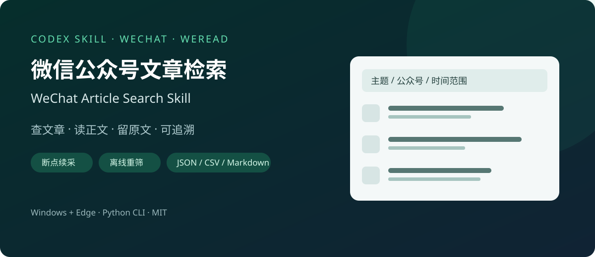

# WeChat Article Search Skill · 微信公众号文章检索

[English](README.en.md) · [安装与运行](#安装与运行) · [示例](#结果示例) · [问题反馈](https://github.com/jayhigh425/wechat-article-search-skill/issues)


[](LICENSE)



**让 AI 帮你找公众号资料，并留下可追溯的原文链接和结果。**

这是一个可安装的 **Codex / Agent Skill**，也能作为独立 Python CLI 使用。通过微信读书（WeRead）的可见搜索页检索微信公众号文章，在本机 Edge 中提取正常可读的正文，支持断点恢复、离线重筛与 JSON / CSV / Markdown 导出。

```text
帮我检索“公司治理与数字化转型”相关的公众号文章，
排除培训广告，读最相关的 5 篇正文，导出可追溯的文章清单。
```

## 能做什么

| 需求 | 能力 |
|---|---|
| 查微信公众号文章 | 多关键词检索，获取标题、公众号、日期、摘要及 mp.weixin.qq.com 原文链接 |
| 读正文、做研究 | 提取可见文字、图片链接和文内链接，逐篇保存 Markdown |
| 精确筛选 | 按日期、公众号、包含/排除关键词筛选；相关性或时间排序 |
| 中断后继续 | 检查点恢复、失败关键词重试、已读正文复用、保留抓取上限 |
| 换条件重筛 | 完整已观察候选池 + 离线 `rank`，不重复联网 |
| 后续分析 | 带状态的 JSON、Excel 可读 CSV、结果摘要和错误诊断 |

**适合**文献线索收集、行业研究、政策资料整理和公众号文章归档。结果会区分已读正文、未读取、图片文章、已删除、客户端限制及风控，不把失败伪装成“没有结果”。

## 安装与运行

### 作为 Codex skill

在 Windows PowerShell 中，将仓库克隆到技能目录；需要已安装 [Git](https://git-scm.com/downloads) 和 [uv](https://docs.astral.sh/uv/getting-started/installation/)。

```powershell
git clone https://github.com/jayhigh425/wechat-article-search-skill.git `
  "$env:USERPROFILE\.codex\skills\wechat-weread-official"
```

目录已经存在时，不要覆盖其中的本地改动。安装后，在识别到该 skill 的 Codex 会话里直接使用：

```text
使用 $wechat-weread-official 检索公司治理相关公众号文章，
保留原文链接，获取最相关的 5 篇可见正文。
```

技能入口是 [SKILL.md](SKILL.md)。其它支持 `SKILL.md` 的代理可按其技能安装方式使用；本仓库未逐一验证这些客户端。

### 作为独立命令行工具

**运行环境：Windows 10/11、Microsoft Edge、uv。**脚本声明 Python 3.11+ 和固定依赖，`uv run` 自动解析环境。检索需要微信读书登录态，首次运行会显示/保存二维码，扫码后继续；直接抓取文章链接不需要先登录微信读书。

```powershell
git clone https://github.com/jayhigh425/wechat-article-search-skill.git
cd wechat-article-search-skill

# 检查环境，不访问网站
uv run .\scripts\wechat_official.py doctor

# 搜索并获取最相关的 5 篇可见正文
uv run .\scripts\wechat_official.py collect `
  --query-file .\examples\search-config.json `
  --fulltext-limit 5 --run-dir .\outputs\research

# 同一任务断点恢复；原正文上限会保留
uv run .\scripts\wechat_official.py collect `
  --run-dir .\outputs\research --resume

# 不联网，按时间重新筛选已观察候选
uv run .\scripts\wechat_official.py rank `
  --input .\outputs\research --sort newest --target 10 `
  --run-dir .\outputs\reranked
```

更多用法见 [SKILL.md](SKILL.md) 和 [运行问题排查](references/runtime-and-troubleshooting.md)。

## 结果示例

下面是**模拟数据**，用于展示文件结构和状态，不代表真实公众号文章。

```text
outputs/research/
├── candidates.json    # 全部已观察候选，保留过滤未通过和超出 target 的条目
├── results.json       # 筛选后的结构化结果与正文状态
├── results.csv        # UTF-8 CSV，可用 Excel 打开
├── summary.md         # 文章清单 + 各关键词覆盖/过滤/停止原因
├── checkpoint.jsonl   # 中断恢复日志
├── articles/          # 正文 Markdown 或纯图片链接清单
└── diagnostics/       # 仅失败时生成的页面截图
```

查看 [模拟结果摘要](examples/sample-output/summary.md)、[模拟 JSON](examples/sample-output/results.json) 与 [输出字段说明](references/output-schema.md)。

## 为什么这样实现

- 原文 URL 用于访问，规范化文章身份用于去重，兼容带参短链接。
- 先执行各关键词，再应用全局目标数量；保留完整**已观察**候选池。
- 等待延迟链接/正文，支持带 `#rd` 的原文链接；避免“页面已显示却报超时”。
- 逐关键词记录错误和过滤原因，便于判断是查询、条件、登录还是页面问题。
- 断点续采可修复截断的日志尾部，已完成内容不重复抓取；风控时停止后续请求。

检索策略见 [研究检索说明](references/research-search.md)。

## 验证与范围

本地验证通过 **34 项单元/流程回归测试**和 **1 套 Edge 浏览器模拟网页测试**。还进行了两个关键词的小规模真实检索：6 条候选、保留 3 条、成功读取 1 篇可见正文（3440 字符、7 张图片）。这些是验证样本，不是速度或覆盖率承诺。GitHub Actions 运行本地模拟测试，不访问真实微信账号。

微信读书索引不保证覆盖全部公众号或历史文章。关键词筛选基于标题、摘要和公众号名称；全文分析需要先读取正文。图片文章标记为 `image_only`，不自动 OCR；已删除、客户端限制及风控状态会保留，不绕过访问限制。暂未验证 macOS/Linux 的浏览器运行路径。

## 参与与支持

如果它帮你减少了资料收集时间，欢迎 **Star**，或分享你的使用场景。页面结构变化、日期解析和恢复问题，请通过 [Issue 模板](https://github.com/jayhigh425/wechat-article-search-skill/issues/new/choose) 提交最小可复现信息；贡献方式见 [CONTRIBUTING.md](CONTRIBUTING.md)。

项目以 [MIT](LICENSE) 协议开源。采集文章仍归原作者所有。
